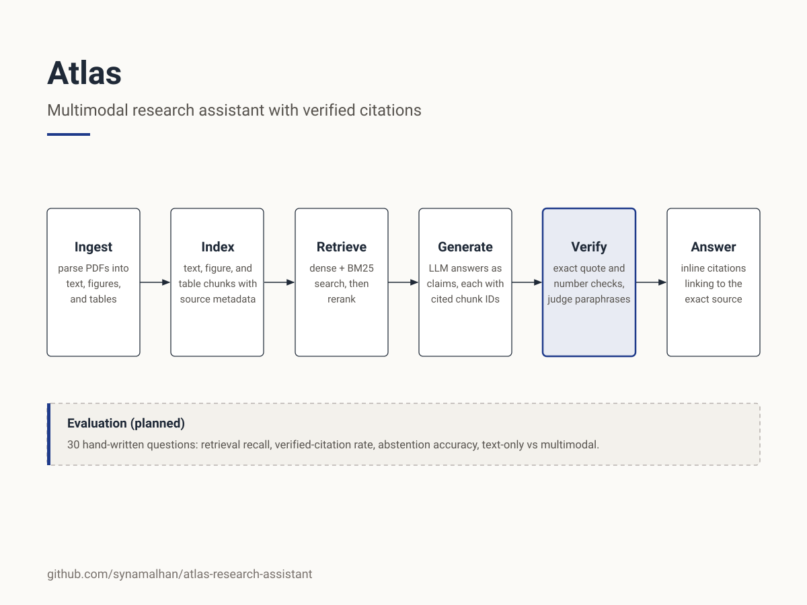

# Atlas

Multimodal research assistant with verified citations.

> **Status: in progress.** This repo currently holds the design only. Nothing is implemented yet, and no results are reported until they are measured.

Atlas answers questions over a small corpus of arXiv papers, reading text, figures, and tables. Every claim in an answer carries a citation, and a verifier checks each citation against the source before the answer is shown.

## Architecture

## Plan

- [ ] Ingest: parse about 50 arXiv PDFs into text, figure, and table chunks
- [ ] Index: store chunks with source metadata
- [ ] Retrieve: dense plus BM25 search, then rerank
- [ ] Generate: answer as claims, each with cited chunk IDs
- [ ] Verify: exact quote and number checks, with a judge for paraphrases
- [ ] Answer UI with inline citations linking to the exact source
- [ ] Evaluation harness and write-up

## Evaluation (planned)

30 hand-written questions. Metrics: retrieval recall, verified-citation rate, abstention accuracy, and text-only vs multimodal comparison.

## Planned stack

Python, a vector index plus BM25, a PDF parser, an LLM API, and a small web UI.

## Notes

Papers are not redistributed here. Check each paper's license before sharing any extracted content.
